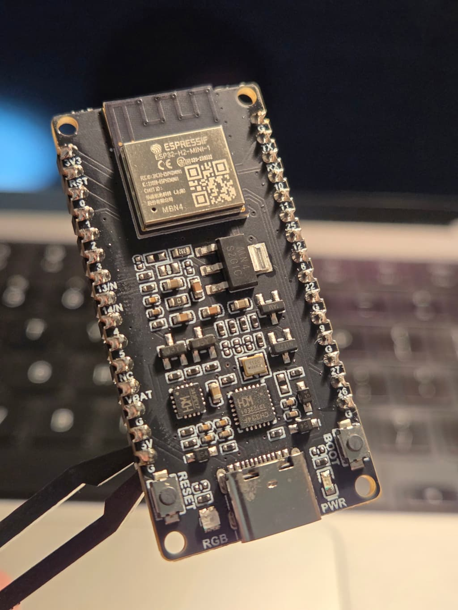
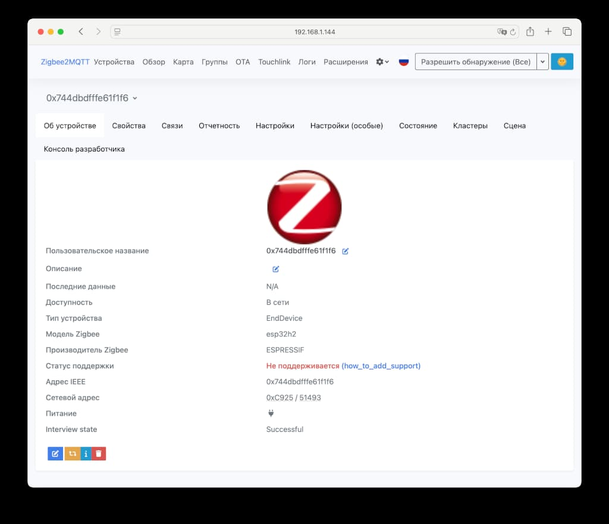
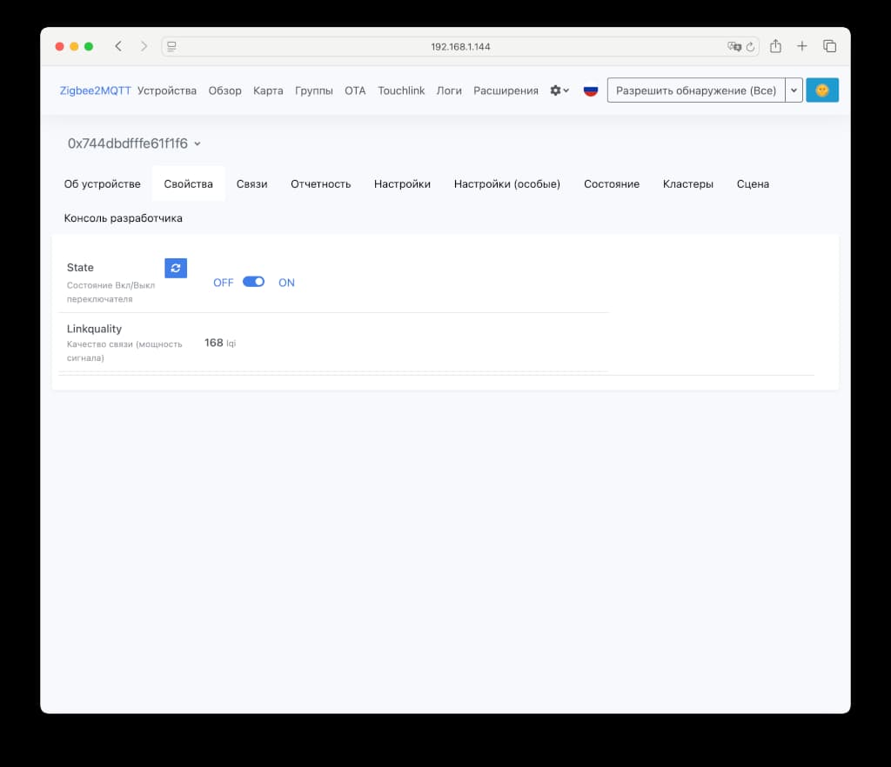
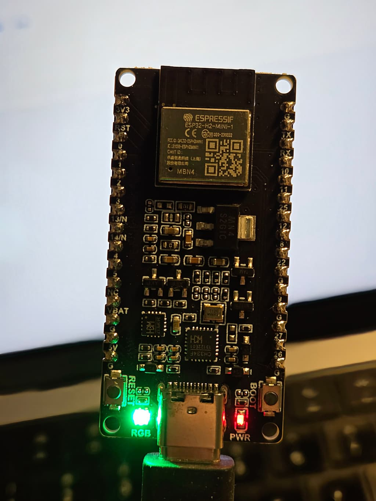

**ESP32-H2-DevKitM-1-N4** - это плата разработки с модулем [ESP32-H2](https://www.espressif.com/en/products/socs/esp32-h2) от компании Espressif.

На плате есть RGB-светодиод, отдельный светодиод для индикации работы, USB Type-C коннектор для подключения к ПК, LDO-регулятор питания с 5V до 3.3V.

Плата поддерживает работу со стандартом Zigbee 3.0, что делает ее интересной для использования в самодельных устройствах для умного дома.

В статье обозревается плата разработки от [WaveShare](https://www.waveshare.com/wiki/ESP32-H2-DEV-KIT-N4).

## Технические характеристики платы разработки

| Свойство            | Значение                                                              |
|---------------------|-----------------------------------------------------------------------|
| Модуль              | ESP32-H2                                                              |
| Микроконтроллер     | Одноядерный, 32-битный RISC-V процессор, тактовая частота до 96 МГц   |
| SRAM                | 320 KB (с 16 KB, которые могут быть настроены как кэш)                |
| Кеш память          | 16 KB (часть SRAM)                                                    |
| ROM                 | 128 KB (встроенная постоянная память)                                 |
| LP память           | 4 KB (Low Power память, ранее RTC-память)                             |
| Flash память        | Встроенная SiP Flash 2 МБ или 4 МБ (в зависимости от варианта модуля) |
| GPIO                | 19 программируемых GPIO (из 28 физических контактов на чипе)          |
| ADC                 | 12-битный SAR ADC, до 5 каналов                                       |
| SPI                 | 1 универсальный SPI-порт (помимо двух для Flash)                      |
| UART                | 2                                                                     |
| I2C                 | 2                                                                     |
| Рабочая температура | от -40°C до +85°C                                                     |

В ESP32-H2 используется несколько типов памяти, каждый со своим назначением. 

**ROM (Read-Only Memory)** содержит неизменяемый код загрузчика и базовые функции системы; 

**SRAM (Static Random-Access Memory)** - это быстрая оперативная память для выполнения кода и хранения данных программы в процессе работы; 

**LP Memory (Low Power Memory)** - это небольшая область памяти, сохраняющая данные даже в энергосберегающих режимах (например, глубокий сон);

**Flash-память** используется для постоянного хранения прошивки вашего приложения и больших объемов данных. 

Основные отличия заключаются в скорости доступа, энергопотреблении и возможности перезаписи: ROM самая быстрая, но неизменяемая; SRAM быстрая, но теряет данные при отключении питания; LP память энергоэффективна, а Flash обеспечивает долговременное хранение.

## ESP32-H2

**ESP32-H2** представляет собой систему на кристалле (SoC), объединяющую в себе следующие ключевые функции:

- **Bluetooth Low Energy**: Поддержка энергоэффективной версии Bluetooth для широкого спектра беспроводных приложений.
- **802.15.4 Thread/Zigbee**: Интеграция стандартов связи Thread и Zigbee, что делает ESP32-H2 идеальным решением для построения сетей умного дома и промышленных IoT-систем.
- **Высокопроизводительный 32-битный одноядерный процессор RISC-V**: Мощное ядро, обеспечивающее быструю обработку данных и эффективное выполнение задач.
- **Множество периферийных устройств**: Широкий набор встроенных периферийных устройств для взаимодействия с различными датчиками, исполнительными механизмами и другими компонентами.
- **Встроенное аппаратное обеспечение безопасности**: Обеспечение надежной защиты данных и систем от несанкционированного доступа.

Созданный с использованием **40-нм технологического процесса**, ESP32-H2 предлагает прочную, высокоинтегрированную платформу, которая помогает удовлетворять постоянно растущие потребности в **эффективном энергопотреблении, компактном дизайне, безопасности, высокой производительности и надежности**.

## ESP-IDF

[ESP-IDF (Espressif IoT Development Framework)](https://docs.espressif.com/projects/esp-idf/en/stable/esp32h2/get-started/index.html) - это основная среда разработки для микроконтроллеров Espressif, таких как ESP32-H2. Она базируется на **FreeRTOS**, что позволяет создавать **многозадачные IoT-приложения**.

Фреймворк предоставляет **полный набор API** для работы со всеми аппаратными функциями чипа (GPIO, ADC, Wi-Fi, Bluetooth, 802.15.4), а также **сетевые протоколы** (TCP/IP, HTTP, MQTT) для подключения к интернету и облачным платформам. **ESP-IDF поддерживает функции безопасности чипа**, включая шифрование и безопасную загрузку, и предлагает **гибкое управление питанием** для энергоэффективных решений. Сборка осуществляется через **CMake**, а компоненты облегчают модульную разработку.

## Zigbee

**ESP32-H2** обладает встроенной поддержкой стандарта беспроводной связи [Zigbee](https://docs.espressif.com/projects/esp-zigbee-sdk/en/latest/esp32/introduction.html), что делает его идеальным выбором для устройств умного дома и промышленных IoT-решений, требующих низкого энергопотребления и надежной ячеистой сети. 

Эта интеграция позволяет ESP32-H2 выступать в роли конечного устройства, маршрутизатора или даже координатора в Zigbee-сети, обеспечивая стабильное и масштабируемое взаимодействие с другими устройствами экосистемы Zigbee без необходимости в дополнительных внешних чипах. 

Благодаря этому, разработчики могут создавать компактные и энергоэффективные устройства, легко интегрируемые в существующие Zigbee-инфраструктуры.

[SDK Espressif для Zigbee](https://docs.espressif.com/projects/esp-zigbee-sdk/en/latest/esp32/introduction.html) построен на базе **ESP-IDF** (фреймворка разработки Espressif) и стека **ZBOSS**.

- [esp-zboss-lib](https://components.espressif.com/components/espressif/esp-zboss-lib): Библиотеки ZBOSS для систем на кристалле (SoC) серии ESP32.
- [esp-zigbee-lib](https://components.espressif.com/components/espressif/esp-zigbee-lib): SDK Espressif для Zigbee и библиотеки API.

Оба этих компонента библиотек размещены в [ESP Registry](https://components.espressif.com/).

## Пример программы для конечного Zigbee устройства

https://github.com/pkolt/esp32-h2/tree/master/zigbee

Наше устройство будет подключаться к умному дому через Zigbee координатор. Вот так оно будет отображаться в Zigbee2MQTT: 

Мы сможем управлять этим устройством - включать/выключать RGB-светодиод.

При переключении состояния на `ON` RGB светодиод включается. При переключении состояния на `OFF` RGB светодиод выключается.

Вместо светодиода мы могли бы использовать GPIO контакты ESP32 и управлять реле или MOSFET-транзистором.

## Выводы

Плата ESP32-H2-DevKitM-1-N4 предназначена для разработки и имеет всю необходимую обвязку.

Модуль ESP32-H2 можно купить отдельно и использовать в собственных платах прошивая через UART.

ESP32-H2 — хорошее решение для самоделок и создания устройств, нацеленных на интеграцию в умный дом Zigbee.
