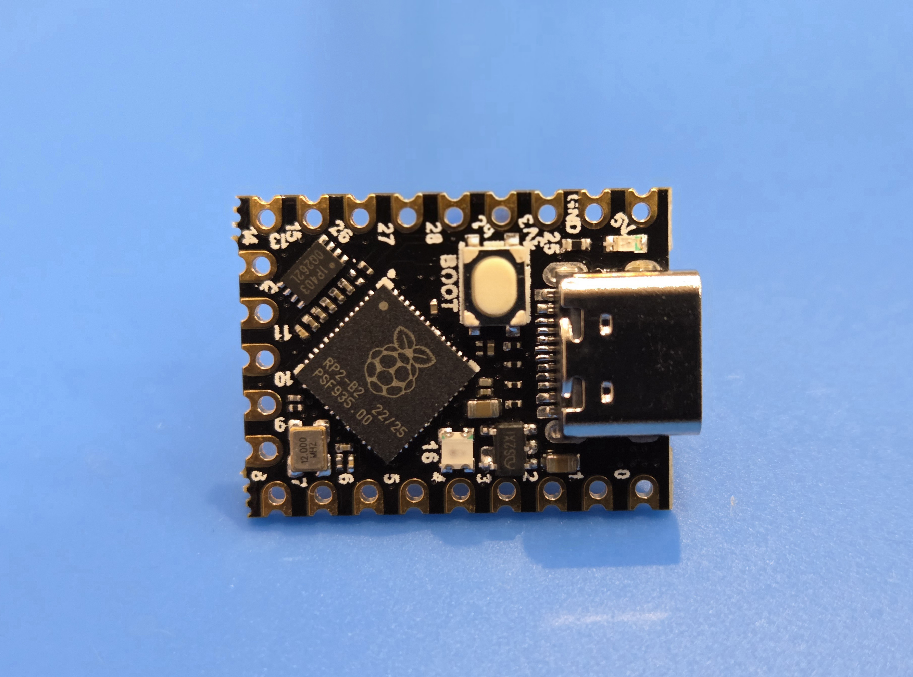
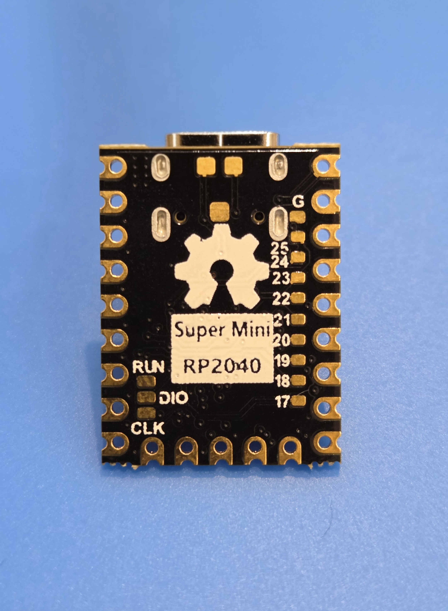
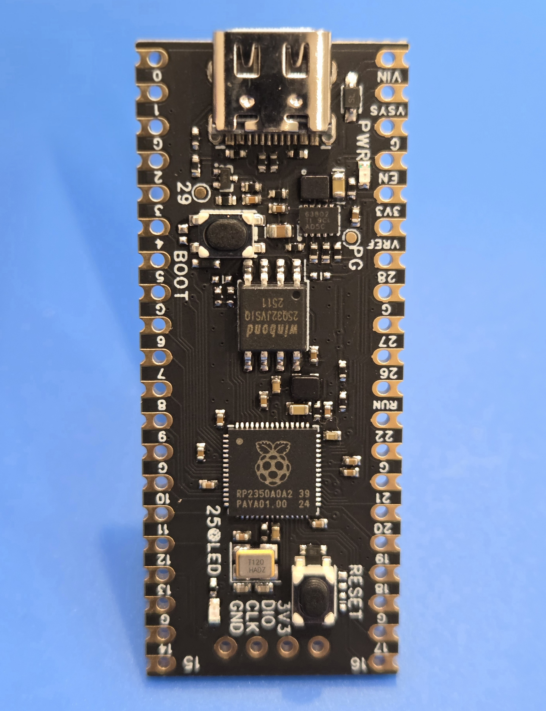
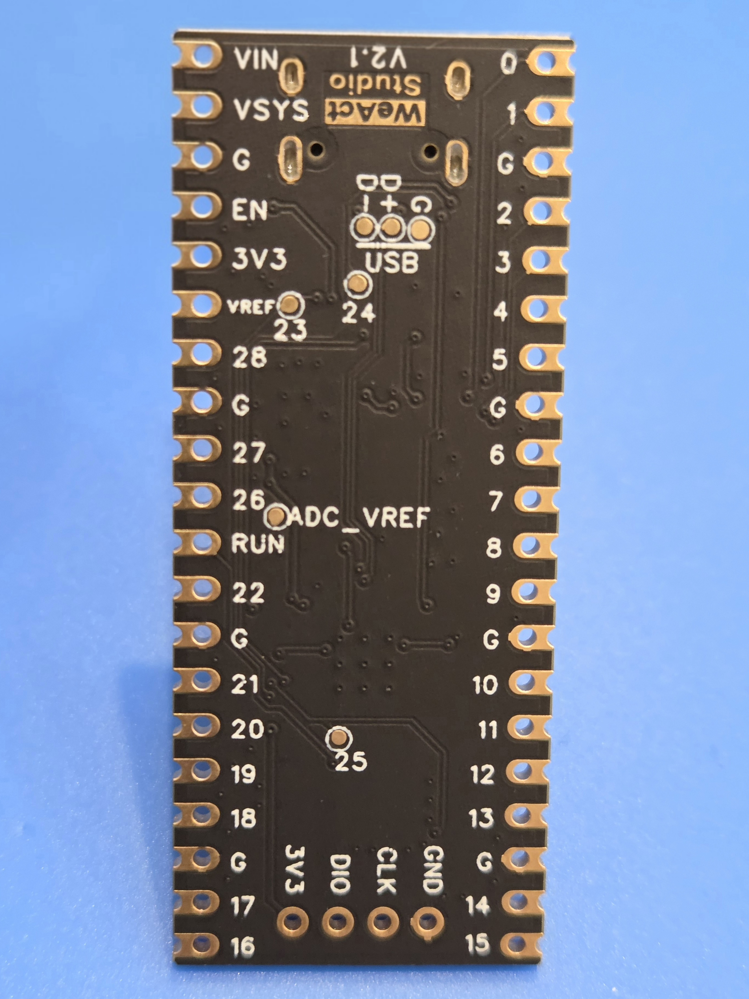

Если вы наигрались с Arduino и вам стало грустно от микроконтроллера, которому в 2026 году исполнится 18 лет, а самому семейству AVR уже почти 30. Если хочется чего-то более современного и такого же простого, как Arduino, то, возможно, вам стоит обратить внимание на микроконтроллеры от компании Raspberry Pi, такие как RP2040 или более новая версия RP2350.

Почему не STM32? Порог вхождения в STM32 гораздо выше для рядового пользователя, поскольку они рассчитаны на более профессиональный подход, углубленное чтение спецификаций и сложную настройку самого микроконтроллера. Они сложнее и займут у вас больше времени. При этом STM32 — достаточно зрелые микроконтроллеры с богатым API и высокой производительностью.

## RP2040




В 2021 году компания Raspberry Pi, известная своими мини-компьютерами, представила свой первый микроконтроллер — RP2040.

Микроконтроллер RP2040 использует двухъядерный процессор ARM Cortex-M0+, работающий на частоте до 133 МГц.

RP2040 оснащён 264 килобайтами встроенной SRAM и не имеет встроенной флеш-памяти — для хранения прошивки используется внешняя SPI флеш-память, что делает устройство гибким в плане конфигурации. Контроллер поддерживает интерфейсы UART, SPI, I²C, PWM и USB, а также имеет 30 универсальных выводов GPIO, часть из которых может работать с аналоговыми сигналами через 12-битный АЦП.

Особое внимание в RP2040 заслуживает блок PIO (Programmable I/O) — уникальная система, позволяющая реализовывать пользовательские протоколы ввода-вывода на аппаратном уровне. Благодаря этому микроконтроллер способен работать с нестандартными интерфейсами и выполнять задачи, которые раньше требовали внешних контроллеров или FPGA.

## RP2350




В 2024 году компания Raspberry Pi выпускает свой второй микроконтроллер — RP2350.

В основе RP2350 лежит новый процессор с двумя ядрами ARM Cortex-M33. Существует также версия с ядром RISC-V, что открывает перед разработчиками выбор между разными экосистемами и инструментами. Одновременно можно использовать только одну версию процессора.

Тактовая частота RP2350 достигает 150 МГц, а объём встроенной SRAM увеличен до 520 килобайт, что позволяет использовать его в более сложных и ресурсоёмких проектах. Как и у предшественника, флеш-память подключается через внешний SPI-интерфейс, однако теперь микроконтроллер поддерживает более быструю и энергоэффективную работу с внешними накопителями.

Набор периферии также стал богаче. Помимо привычных интерфейсов SPI, I²C, UART, PWM и USB, RP2350 получил поддержку CAN и I3C, что делает его удобным для использования в промышленных и автомобильных решениях. Количество выводов GPIO увеличилось до 48, и они по-прежнему могут работать с аналоговыми сигналами через улучшенный 12-битный АЦП.

Особое внимание снова уделено системе PIO (Programmable I/O), которая в RP2350 стала ещё мощнее и гибче. Теперь она позволяет создавать более сложные пользовательские протоколы и взаимодействовать с периферией с минимальной нагрузкой на основные ядра.

### Ошибки RP2350

К сожалению, при выходе RP2350 было найдено несколько критических ошибок, вот некоторые из них:
- **Erratum RP2350-E9** — когда вывод настраивается как вход с включённым внутренним pull-down, а затем поднимается до высокого уровня (например, 3.3 В), он не возвращается полностью к 0 В после снятия сигнала. Вместо этого он остаётся на уровне ~2.1-2.2 В — это явление называется эффектом защёлкивания (latching behaviour).
- Уязвимости, найденные в Boot ROM в рамках Hacking Challenge.

Описанные выше ошибки исправлены в версии чипа со степпингом A4. Потребуется некоторое время, чтобы новые чипы вытеснили старые, содержащие ошибки.

## Таблица сравнения микроконтроллеров

| Характеристика                   | RP2040                                  | RP2350                                               |
|----------------------------------|-----------------------------------------|------------------------------------------------------|
| **Год выпуска**                  | 2021                                    | 2024                                                 |
| **Архитектура CPU**              | Dual-core ARM Cortex-M0+                | Dual-core Cortex-M33 **или** RISC-V (PicoRV32-based) |
| **Тактовая частота**             | До 133 МГц                              | До 150 МГц (ARM) / до 200 МГц (RISC-V)               |
| **Память SRAM**                  | 264 КБ                                  | 520 КБ                                               |
| **Встроенная флеш-память**       | Нет (внешняя QSPI-Flash)                | Нет (внешняя QSPI или Octal SPI Flash)               |
| **Интерфейсы ввода-вывода**      | GPIO, SPI, I²C, UART, PWM, PIO (2× PIO) | GPIO, SPI, I²C, UART, PWM, PIO (2× улучшенные PIO)   |
| **Поддержка USB**                | USB 1.1 Device/Host                     | USB 1.1 Device/Host (улучшена надёжность)            |
| **DMA**                          | 12 каналов                              | 16 каналов                                           |
| **ADC**                          | 12-бит, 4 канала                        | 12-бит, 4 канала + температурный сенсор              |
| **Аппаратная безопасность**      | Нет                                     | TrustZone-M, криптографические инструкции            |
| **Аппаратный FPU**               | Нет                                     | Есть (в Cortex-M33)                                  |
| **RTC (часы реального времени)** | Нет                                     | Да                                                   |
| **Питание (рабочее напряжение)** | 1.8-3.3 В                               | 1.8-3.3 В                                            |
| **Количество GPIO**              | 30                                      | 30 для RP2350A и 48 для RP2350B                      |
| **Корпус**                       | QFN-56, WLCSP-56                        | QFN-56, WLCSP-56 (совместимый пин-аут)               |
| **Совместимость с RP2040**       | —                                       | Почти полная (пины и периферия совместимы)           |
| **Особенности**                  | Простая архитектура, высокая надёжность | ARM + RISC-V, больше памяти, поддержка безопасности  |
| **Пример платы**                 | Raspberry Pi Pico                       | Raspberry Pi Pico 2                                  |

Чем RP2350 лучше, чем RP2040?

- RP2350 может работать с двумя типами процессоров: ARM Cortex-M33 или RISC-V.
- У него в два раза больше памяти (520 КБ против 264 КБ).
- Частота немного выше, поэтому он быстрее.
- Появилась аппаратная безопасность: TrustZone и криптографические инструкции.
- Есть FPU — это ускоритель для математических вычислений.
- RTC стал полноценным: теперь он может работать в спящем режиме и будить микроконтроллер.
- Улучшены PIO, DMA и работа с USB.

## Примеры использования

Микроконтроллеры Raspberry Pi можно программировать на MicroPython, а также на C/C++.

Для C/C++ существует [SDK](https://github.com/raspberrypi/pico-sdk), в дальнейшем мы будем использовать именно его.

Прошивка платы довольно проста. Достаточно нажать и удерживать кнопку BOOTSEL, подключая её к ПК по USB. После этого плата отобразится в системе как флеш-накопитель, на который нужно скопировать файл прошивки в формате `.uf2`. Затем устройство автоматически перезагрузится и запустит вашу программу.

Однако удобнее всего использовать редактор кода VS Code с расширением "Raspberry Pi Pico". Оно само установит необходимые зависимости и позволит прошивать плату одним нажатием кнопки.

Простейшая программа мигания светодиодом на RP2350:

```c
#include "pico/stdlib.h"

#define LED_PIN 25
#define LED_DELAY_MS 1000

// Инициализация LED
void led_init(void) {
    gpio_init(LED_PIN);
    gpio_set_dir(LED_PIN, GPIO_OUT);
}

// Установка состояния LED
void led_set_state(bool state) {
    gpio_put(LED_PIN, state);
}

int main() {
    led_init();
    
    while (true) {
        led_set_state(true);
        sleep_ms(LED_DELAY_MS);
        
        led_set_state(false);
        sleep_ms(LED_DELAY_MS);
    }
}
```